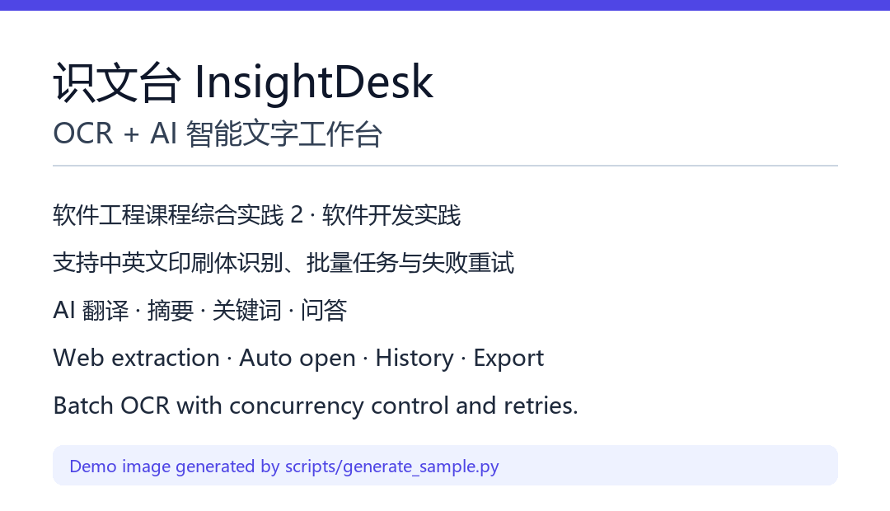

# 识文台 InsightDesk

[](https://github.com/luohao-code/insightdesk/actions/workflows/ci.yml)
[](https://www.python.org/)
[](https://fastapi.tiangolo.com/)
[](LICENSE)

> OCR + AI 智能文字工作台：把图片与网页里的文字，变成可编辑、可检索、可导出的个人资产。

识文台是一套**基于 Web** 的文字处理应用，使用 Python + FastAPI 提供后端能力，浏览器原生 ES Module 构建前端，支持本地离线 OCR 与多家云端 OCR / 大模型。除 Web 形态外，项目提供桌面启动器：双击 exe 后启动本地服务，并**自动打开默认浏览器**。

本项目为《课程综合实践 2：软件开发实践》团队项目，满足"有创意、上规模、高质量"的综合实践要求。

<p align="center">
  
</p>

---

## 目录

- [功能特性](#功能特性)
- [技术架构](#技术架构)
- [快速开始](#快速开始)
- [配置说明](#配置说明)
- [桌面打包](#桌面打包)
- [Docker 部署](#docker-部署)
- [项目结构](#项目结构)
- [测试与质量](#测试与质量)
- [接口文档](#接口文档)
- [团队分工](#团队分工)
- [项目文档](#项目文档)
- [许可证](#许可证)

---

## 功能特性

| 模块 | 能力 | 说明 |
| --- | --- | --- |
| 图片导入 | 单张 / 多张 / 拖拽 / 粘贴截图 | 支持 PNG、JPG、WEBP、BMP、TIFF、GIF |
| OCR 识别 | 中英文印刷体 | RapidOCR 本地离线、百度 OCR、腾讯 OCR、内置演示引擎 |
| 结果编辑 | 在线编辑、自动保存、复制 | 保留原始识别文本，支持版本号 |
| 批量任务 | 队列、并发限流、实时进度、失败重试、取消 | SSE 推送进度，100 张图片稳定执行 |
| AI 加工 | 翻译、摘要、关键词、问答、润色、提纲 | 兼容 DeepSeek / Kimi / 智谱 / 通义 / 任意 OpenAI 兼容服务 |
| 历史资产 | 全文检索、筛选、标签、收藏、批量操作 | SQLite + FTS5（trigram），万级数据可检索 |
| 多格式导出 | TXT / CSV / Markdown / Word / Excel / JSON / ZIP | 中文无乱码，带元信息 |
| 网页提取 | 标题、作者、正文、配图 | 多候选容器打分，SSRF 防护，逐跳校验重定向 |
| 自动打开 | 提取后自动打开原文；启动后自动打开应用 | 桌面模式调用系统浏览器，Web 模式新标签页 |
| 设置中心 | 引擎、密钥、并发、重试、外观、数据清理 | 密钥仅存服务端，接口返回自动脱敏 |
| 运行看板 | 资产量、成功率、耗时、引擎分布、7 日趋势 | 零依赖 SVG 图表 |

**明确不做**：本地大模型训练、手写/公式/复杂表格识别、自动排版报告、视频理解、多用户账号与支付。

---

## 技术架构

```text
┌──────────────────────────────────────────────────────────────────┐
│                        浏览器（原生 ES Module）                    │
│  看板 · OCR 工作台 · 批量任务 · AI 助手 · 历史 · 网页 · 设置 · 帮助  │
│            CSS 设计令牌 · 零依赖 SVG 图表 · SSE 实时进度            │
└───────────────────────────────┬──────────────────────────────────┘
                                │ REST / SSE / multipart
┌───────────────────────────────▼──────────────────────────────────┐
│                        FastAPI 应用（分层）                        │
│   api 接口层 → services 业务层 → providers 能力层 → models 数据层   │
│   任务队列（线程池 + 信号量 + 指数退避） · 事件总线 · 安全工具       │
└───────┬───────────────────┬───────────────────────┬──────────────┘
        │                   │                       │
┌───────▼────────┐  ┌───────▼────────┐      ┌───────▼─────────────┐
│ SQLite (WAL)   │  │ OCR Providers  │      │ AI Providers        │
│ SQLAlchemy 2.0 │  │ RapidOCR       │      │ DeepSeek / Kimi     │
│ FTS5 全文索引   │  │ 百度 / 腾讯     │      │ 智谱 / 通义 / 自定义 │
└────────────────┘  └────────────────┘      └─────────────────────┘
```

**关键设计**

- **可插拔引擎**：OCR 与 AI 均通过注册表 + 统一接口扩展，新增平台无需改动业务逻辑。
- **失败不扩散**：单任务异常被捕获、重试并记录原因；批次状态持久化，服务重启后可恢复为可重试状态。
- **安全默认**：网页抓取禁止内网/环回/保留地址，限制响应体大小；密钥仅存服务端并脱敏返回。
- **零构建前端**：不依赖 npm / CDN，离线可用，直接由 FastAPI 托管。

---

## 快速开始

### 环境要求

- Python 3.10+（推荐 3.12）
- Windows 10/11、Ubuntu 20.04+ 或 macOS 12+
- 现代浏览器（Chrome / Edge / Firefox / Safari）

### Windows

```powershell
cd insightdesk
py -3.12 -m venv .venv
.\.venv\Scripts\activate
pip install -r requirements.txt

# 可选：启用本地离线 OCR
pip install rapidocr-onnxruntime

python run.py
```

启动后会自动打开浏览器；如未自动打开，请访问 `http://127.0.0.1:8770`。

### macOS / Linux

```bash
python3 -m venv .venv
source .venv/bin/activate
pip install -r requirements.txt
python run.py
```

### 常用启动参数

```bash
python run.py --port 9000      # 指定端口
python run.py --no-browser     # 不自动打开浏览器
python run.py --reload         # 开发热重载
python run.py --host 0.0.0.0   # 允许局域网访问（请自行评估安全风险）
```

---

## 配置说明

首次启动默认使用**演示引擎**，无需任何密钥即可体验完整流程（识别结果为模拟文本）。真实能力可在「设置」页配置：

| 配置项 | 默认值 | 说明 |
| --- | --- | --- |
| `ocr_engine` | `mock` | `mock` / `rapidocr` / `baidu` / `tencent` |
| `ai_provider` | `mock` | `mock` / `deepseek` / `kimi` / `zhipu` / `qwen` / `custom` |
| `ai_base_url` | `https://api.deepseek.com/v1` | OpenAI 兼容接口地址 |
| `ai_model` | `deepseek-chat` | 模型名称 |
| `concurrency` | `3` | 批量并发（1–8） |
| `max_retries` | `2` | 单任务最大重试次数 |
| `auto_open_web` | `true` | 网页提取后自动打开原文 |
| `keep_uploads_days` | `30` | 上传文件保留天数 |

> 密钥只保存在 `data/insightdesk.db`，接口返回统一显示为 `••••••••`；前后端代码与打包产物中不包含任何密钥。

数据目录默认为项目下 `data/`，可通过环境变量重定向：

```bash
# Windows PowerShell
$env:INSIGHTDESK_DATA_DIR = "D:\insightdesk-data"

# macOS / Linux
export INSIGHTDESK_DATA_DIR=/var/lib/insightdesk
```

---

## 桌面打包

```powershell
# 安装打包依赖
pip install pyinstaller

# 生成 release/InsightDesk.exe
powershell -ExecutionPolicy Bypass -File desktop/build_exe.ps1

# 或直接使用 spec
pyinstaller desktop/insightdesk.spec --noconfirm
```

桌面版特性：

- 数据保存在 `%APPDATA%\InsightDesk\data`，不污染程序目录；
- 启动后自动选择空闲端口并打开默认浏览器；
- 启动失败时弹出系统提示，并将详细日志写入 `logs/launcher_error.log`。

---

## Docker 部署

```bash
docker compose up -d --build
# 访问 http://127.0.0.1:8770
```

`docker-compose.yml` 会把宿主机 `./data` 挂载到容器内，便于持久化。容器模式不自动打开浏览器，适合部署在服务器或 NAS。

---

## 项目结构

```text
insightdesk/
├─ backend/                 # FastAPI 后端
│  ├─ api/                  # 接口层（OCR、任务、AI、历史、导出、网页、设置、统计）
│  ├─ services/             # 业务层（队列、AI、导出、网页提取、清理等）
│  ├─ providers/            # 能力层（OCR / AI 适配与注册表）
│  ├─ models/               # SQLAlchemy 模型
│  ├─ schemas/              # Pydantic 数据结构
│  ├─ prompts/              # 提示词库
│  ├─ utils/                # 文本、图片、文件、安全、时间工具
│  ├─ config.py             # 部署配置与默认设置
│  ├─ db.py                 # SQLite / WAL / FTS5
│  └─ main.py               # 应用入口
├─ frontend/                # 原生 ES Module 单页应用
│  ├─ css/                  # 设计令牌、布局、组件、页面、动画
│  ├─ js/pages/             # 8 个页面
│  ├─ js/components/        # 弹窗、提示、上传器、编辑器、图表等
│  └─ index.html
├─ desktop/                 # 桌面启动器与 PyInstaller 配置
├─ tests/                   # pytest 测试（87 项）
├─ scripts/                 # 冒烟测试、代码行数统计、示例图生成
├─ docs/                    # 需求、设计、测试、手册、进展报告
├─ .github/workflows/ci.yml # 持续集成
├─ Dockerfile
├─ docker-compose.yml
├─ run.py                   # 本地启动（自动打开浏览器）
└─ requirements.txt
```

---

## 测试与质量

```bash
pip install -r requirements-dev.txt
pytest -q                    # 87 项测试
python scripts/smoke_test.py # 端到端冒烟
python scripts/count_lines.py
```

当前质量指标：

| 指标 | 结果 |
| --- | --- |
| 自动化测试 | **87 passed** |
| 物理代码行 | **21,142 行**（含测试） |
| 有效代码行 | **17,619 行** |
| 覆盖模块 | 健康检查、OCR、批量任务、AI、历史、导出、网页提取、设置、工具函数 |
| 静态检查 | 全部前端模块通过 `node --check` |
| 真实 OCR 验证 | RapidOCR 成功识别中英文示例图 |

CI 会在每次 push / PR 时执行后端测试、前端语法检查与代码规模校验。

---

## 接口文档

启动后访问：

- Swagger UI：`http://127.0.0.1:8770/api/docs`
- OpenAPI JSON：`http://127.0.0.1:8770/api/openapi.json`
- 健康检查：`http://127.0.0.1:8770/api/health`

主要接口：

```text
POST /api/ocr/upload            上传图片
POST /api/ocr/recognize         单图识别
POST /api/tasks/batches         创建批量任务
GET  /api/tasks/stream          SSE 进度流
POST /api/ai/process            翻译 / 摘要 / 关键词 / 问答
GET  /api/history               历史检索
POST /api/export                导出记录
POST /api/web/extract           网页正文提取
POST /api/web/open              调用系统浏览器打开
GET  /api/settings              读取设置（密钥脱敏）
```

完整说明见 [详细设计说明书](docs/03-详细设计说明书.md)。

---

## 团队分工

| 成员 | 角色 | 主要职责 | 贡献 |
| --- | --- | --- | --- |
| **杨文杰** | 项目负责人 / 小组长 / 前端负责人 | 项目统筹与进度管理、设计系统、8 个页面与组件、SSE 进度、图表、评审与发布 | 35% |
| **罗浩** | 架构与后端负责人 | 需求基线、架构设计、任务队列、网页提取与安全、集成、进展报告 | 35% |
| **邹俊杰** | 算法与质量负责人 | OCR/AI 引擎适配、提示词工程、导出、自动化测试、打包与手册 | 30% |

详细 RACI 与协作规范见 [团队分工与协作规范](docs/08-团队分工与协作规范.md)。

---

## 项目文档

| 文档 | 说明 |
| --- | --- |
| [软件需求规格说明书](docs/01-软件需求规格说明书.md) | 需求基线、功能与非功能需求、验收标准 |
| [概要设计说明书](docs/02-概要设计说明书.md) | 架构、模块划分、关键技术决策 |
| [详细设计说明书](docs/03-详细设计说明书.md) | 数据模型、接口契约、核心流程、异常处理 |
| [测试报告](docs/04-测试报告.md) | 测试策略、用例、结果与缺陷记录 |
| [用户手册](docs/05-用户手册.md) | 安装、使用流程、常见问题 |
| [部署与运维手册](docs/06-部署与运维手册.md) | 本地、Docker、桌面、备份与排障 |
| [AI 生成式开发经验分享](docs/07-AI生成式开发经验分享.md) | 提示词、分工、质量控制的实践总结 |
| [阶段一正式报告（Word）](docs/阶段一正式报告-团队分工与项目进展.docx) | 含封面的正式报告：团队分工 + 阶段一进展 |
| [阶段一进展报告](docs/进展报告/阶段一-需求与设计.md) | 需求与设计阶段 |
| [阶段二进展报告](docs/进展报告/阶段二-核心开发.md) | 核心功能开发阶段 |
| [阶段三进展报告](docs/进展报告/阶段三-测试与交付.md) | 测试、打包与交付阶段 |
| [团队分工与协作规范](docs/08-团队分工与协作规范.md) | 角色、RACI、分支与提交规范 |

---

## 许可证

本项目采用 [MIT License](LICENSE)。第三方组件遵循各自许可证，详见文档说明。

---

<p align="center">
  <sub>识文台 InsightDesk v1.0.0 · 课程综合实践 2 · 2026</sub>
</p>
